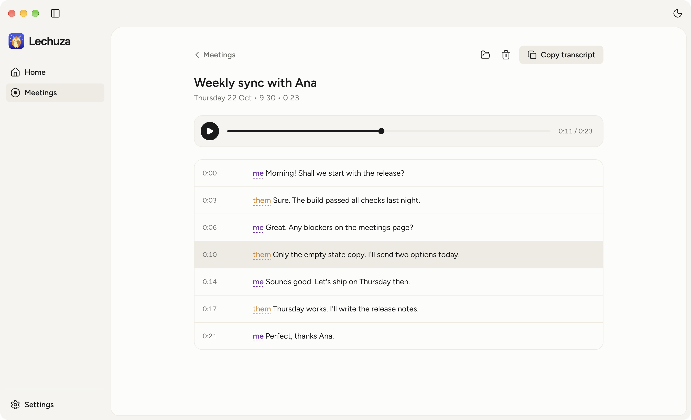

# Lechuza

Lechuza (Spanish for barn owl) is an open-source, on-device voice app for macOS:

- **Meetings.** Record any call: your microphone and the call's audio become two tracks and a `me` / `them` transcript. Play it back, read along, and copy the whole transcript.
- **Dictation** (coming, [issue #4](https://github.com/JorgeMenaDev/lechuza/issues/4)). Hold a key, speak, and the text appears wherever you type.

Transcription runs on your Mac with Parakeet. Nothing leaves the machine.

Work in progress: the v1 plan is [issue #1](https://github.com/JorgeMenaDev/lechuza/issues/1).



## Meetings

Lechuza lives in the menu bar as an owl. Click it for **Start meeting**, **Stop meeting** (with the elapsed time), **Open Lechuza** and **Quit Lechuza**. The Meetings page has the same Start and Stop button.

A meeting records two tracks at once: your microphone (`me`) and everything your Mac plays, which is the other side of the call (`them`). When you stop, Lechuza mixes them into one file you can play, then transcribes each track. The first transcription downloads the Parakeet v3 speech model (about 470 MB, once), with progress on the Meetings page. Parakeet v3 understands English, Spanish and 23 other European languages.

On the Meetings page, every meeting shows its title, date, length and state: recording, transcribing, ready or failed. Open one to:

- **Play** it. The transcript line being spoken lights up. Click any line to jump there.
- **Copy transcript** as plain text, one line per sentence: `[0:05] them: Sí, claro…`
- **Rename** it by clicking the title.
- **Show in Finder** or **Delete** (to the Trash).
- **Retry** a transcription that failed.

Each meeting is a plain folder in `~/Documents/Lechuza/Meetings/<yyyy-MM-dd-HHmm>/`:

| File | What it is |
| --- | --- |
| `mic.caf`, `system.caf` | The two tracks, AAC. A capture restart adds `mic-002.caf`… |
| `meeting.m4a` | Both tracks mixed, for playback |
| `transcript.md`, `transcript.json` | The `me` / `them` transcript with timestamps |
| `meta.json` | Start, length, track health and your title |

Lechuza has no echo cancellation yet: without headphones, your microphone also hears the other side, so some of their words appear under `me` too.

## Permissions

Lechuza asks for three permissions, all in its own name: **Documents** at first launch (meetings are saved there), then **Microphone** and **System Audio Recording** at the first meeting. If you said no, allow them in System Settings → Privacy & Security, then start a new meeting.

Lechuza needs macOS 15 or later on Apple silicon.

## Build from source

You need [Bun](https://bun.sh) 1.2 or later and Xcode 16 or later (Swift 6).

```sh
git clone https://github.com/JorgeMenaDev/lechuza.git
cd lechuza
bun install
bun run dev      # engine debug build + Vite + Electron; the interface hot-reloads
bun run dist     # builds apps/desktop/release/Lechuza-<version>-arm64.dmg
```

Checks: `bun run typecheck`, `bun test`, and `swift test --package-path engine`. The engine's speech test makes English and Spanish audio with `say` and transcribes it, so its first run downloads the model.

`LECHUZA_MEETINGS_DIR=/some/folder bun run dev` points the app at another meetings folder, for demos and screenshots.

> If your terminal sets `ELECTRON_RUN_AS_NODE=1` (some editor terminals do), Electron starts as plain Node. Run `env -u ELECTRON_RUN_AS_NODE bun run dev` instead.

## How it works

Lechuza is shaped like [Pudu](https://github.com/JorgeMenaDev/pudu): an Electron shell, one React renderer and a shared contracts package. Audio capture and transcription live in a small Swift helper, `lechuza-engine`, that the app ships inside itself and runs as a child process.

```
packages/contracts     Types and IPC channels shared by every process
  src/engine.ts          The app ↔ engine protocol (JSON lines), with a runtime parser
  fixtures/              One example of every engine message; both sides' tests read it
apps/desktop           Electron main process
  meetings.ts            Recording and transcription lifecycle (the single source of state)
  engineProcess.ts       Spawns lechuza-engine and speaks the protocol
  library.ts             Meeting folders on disk: list, rename, transcript
  mediaProtocol.ts       lechuza-media:// with byte ranges, so the player can seek
  main.ts                Menu bar, IPC, wiring
apps/web               React 19 + Vite + Tailwind 4; one bundle, #/surface picks the screen
  surfaces/Meetings.tsx  The Meetings page
  index.css              Every style, by class name
engine/                Swift package: the lechuza-engine helper
  Audio/                 Microphone (AVAudioEngine) and system audio (Core Audio process tap)
  RecordingSession.swift Both tracks on one clock, with capture health in meta.json
  Mixer.swift            Both tracks to meeting.m4a (AVFoundation)
  Transcription/         Parakeet v3 through FluidAudio; me / them transcript
```

A meeting, step by step:

1. **Start** sends `meeting.start` to the engine. macOS asks for Microphone and System Audio Recording on behalf of Lechuza, because the engine is its child process.
2. The engine writes both tracks to the meeting folder and streams input levels back.
3. **Stop** sends `meeting.stop`. The engine finishes the tracks, writes `meta.json` and mixes `meeting.m4a`.
4. The app queues `transcription.start`. The engine downloads the model if needed, transcribes each track, and writes the transcript.
5. The main process broadcasts every change to the window, which renders it.

## Credits

- [Quill](https://github.com/humanitas-labs/quill) by Humanitas Labs. The engine's two-track capture, capture health, session metadata and Parakeet transcription are adapted from Quill (MIT; see [NOTICE](NOTICE)).
- [FluidAudio](https://github.com/FluidInference/FluidAudio) runs [Parakeet TDT 0.6B v3](https://huggingface.co/nvidia/parakeet-tdt-0.6b-v3) on the Neural Engine.

## License

[MIT](LICENSE).
