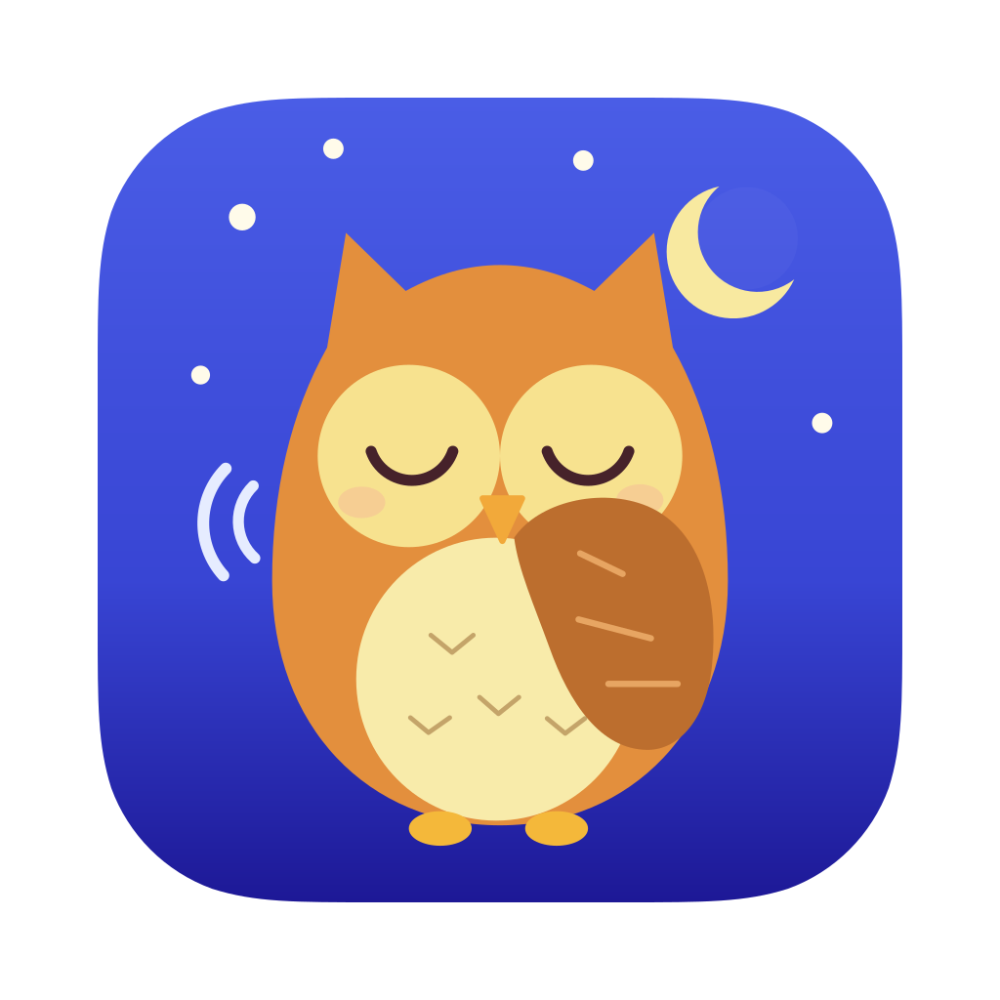

<p align="center"></p>

<h1 align="center">Lechuza</h1>

<p align="center"><em>"La lechuza, la lechuza, hace shhh, hace shhh..."</em></p>

A small macOS menu-bar app for dictation and meetings. Double-press `fn`, start talking, and your words are typed into whatever text field has the cursor. Start a meeting and Lechuza records you and the call, then gives you a transcript you can replay, follow along and copy. Speech is transcribed on your Mac, so audio never leaves your machine.

Why "Lechuza"? It's named after the Spanish children's song *La lechuza*, where the owl goes "shhh". Lechuza is built for quiet dictation in offices and shared spaces, where you whisper slowly instead of talking out loud.

## Features

- **Dictation.** Double-press `fn` to start dictating, and press it once to stop. Or hold `fn` to talk: dictation runs while it's held and stops on release. Both work at any time, with no setting. Esc cancels. Prefer another key? Pick right Option, right Command or Control + Option in Settings.
- **Meeting recording.** Start a meeting from the menu bar. Lechuza records your microphone (`me`) and the call's audio (`them`) as separate tracks, then writes a timestamped `me` / `them` transcript.
- **Meetings dashboard.** Replay any meeting, follow the transcript as it plays, click a line to jump there, and copy the whole transcript in one click.
- **On-device.** Transcription runs on your Mac with Parakeet, in English, Spanish and 23 other European languages.


## Status

In development. The v1 plan is [issue #1](https://github.com/JorgeMenaDev/lechuza/issues/1).

## Dictation

Put the cursor in any text field, in any app, and dictate:

- **Hold** the key, speak, and let go.
- **Double-press** it to talk hands-free, then press it once more (or click ■ on the Flow bar) to stop.
- **Esc** throws the dictation away.

Your words are pasted where the cursor is, about a second after you stop. Lechuza puts them on the clipboard, presses ⌘V for you, then puts back what the clipboard held before. It boosts quiet input, so a whisper transcribes like normal speech.

The **Flow bar** is a small pill at the bottom of the screen, on every Space and over full-screen apps. It never takes focus from the app you're typing in. Point at it and click to start dictating. While you talk it shows a live waveform, then dots while Parakeet transcribes. A red edge means something went wrong; point at it to read what. A short sound plays when dictation starts and stops (turn it off in Settings).

Home lists every dictation next to your meetings, with a button to copy it, and adds up the words you've dictated and your words per minute. They are kept in `dictations.jsonl` in Lechuza's data folder (`~/Library/Application Support/Lechuza`).

## Meetings

Lechuza lives in the menu bar as an owl. Click it for **Start meeting**, **Stop meeting** (with the elapsed time), **Open Lechuza** and **Quit Lechuza**. The Meetings page has the same Start and Stop button.

A meeting records two tracks at once: your microphone (`me`) and everything your Mac plays, which is the other side of the call (`them`). When you stop, Lechuza mixes them into one file you can play, then transcribes each track. The first transcription downloads the Parakeet v3 speech model (about 470 MB, once), with progress on the Meetings page.

On the Meetings page, every meeting shows its title, date, length and state: recording, transcribing, ready or failed. Point at one to read the start of its transcript in the side pane. Open one to:

- **Play** it. The transcript line being spoken lights up. Click any line to jump there.
- **Copy transcript** as plain text, one line per sentence: `[0:05] them: Sí, claro…`
- **Rename** it by clicking the title.
- **Show in Finder** or **Delete** (to the Trash).
- **Retry** a transcription that failed.

If the engine crashes mid-meeting, Lechuza recovers the recording when the engine restarts, marks it incomplete, and transcribes it.

Each meeting is a plain folder in `~/Documents/Lechuza/Meetings/<yyyy-MM-dd-HHmm>/`:

| File | What it is |
| --- | --- |
| `mic.aac`, `system.aac` | The two tracks, AAC (ADTS, so a crash never leaves them unreadable). A capture restart adds `mic-002.aac`… |
| `meeting.m4a` | Both tracks mixed, for playback |
| `transcript.md`, `transcript.json` | The `me` / `them` transcript with timestamps |
| `recording.json` | While recording, the tracks so far. A crash leaves it behind, and the next launch recovers the meeting from it |
| `meta.json` | Start, length, track health and your title |

Without headphones, your microphone also hears the other side. When a `me` line repeats what `them` said at that moment, the transcript leaves it out, so each line appears once.

## Home and Settings

Home greets you, lists your recent meetings and dictations by day, and adds up the words you've dictated, your words per minute, how many meetings you've had and how long you've recorded. **Settings**, at the bottom of the sidebar, has the dictation key, sounds, the theme, your microphone, the speech model, the meetings folder, permissions and the version. The theme follows your Mac's appearance, or pick Light or Dark there or with the moon at the top right.

## Permissions

Lechuza asks for these permissions, all in its own name:

- **Documents** at first launch: meetings are saved there.
- **Accessibility** for dictation, so Lechuza can hear the dictation key in every app and paste your words. Home shows a button for it until it's allowed.
- **Microphone** at the first meeting or dictation.
- **System Audio Recording** at the first meeting.

If you said no, allow them in System Settings → Privacy & Security, then try again.

With `fn` as the dictation key, set **Press 🌐 key to** to **Do Nothing** in System Settings → Keyboard, or macOS also acts on the key (emoji picker, input sources or its own dictation). Lechuza tells you when it isn't.

Lechuza needs macOS 15 or later on Apple silicon.

## Build from source

You need [Bun](https://bun.sh) 1.2 or later and Xcode 16 or later (Swift 6).

```sh
git clone https://github.com/JorgeMenaDev/lechuza.git
cd lechuza
bun install
bun run dev      # engine debug build + Vite + Electron; the interface hot-reloads
bun run dist     # builds apps/desktop/release/Lechuza-<version>-arm64.dmg
```

Checks: `bun run typecheck`, `bun test`, and `swift test --package-path engine`. The engine's speech test makes English and Spanish audio with `say` and transcribes it, so its first run downloads the model.

`LECHUZA_MEETINGS_DIR=/some/folder bun run dev` points the app at another meetings folder, for demos and screenshots.

> If your terminal sets `ELECTRON_RUN_AS_NODE=1` (some editor terminals do), Electron starts as plain Node. Run `env -u ELECTRON_RUN_AS_NODE bun run dev` instead.

## How it works

Lechuza is shaped like [Pudu](https://github.com/JorgeMenaDev/pudu): an Electron shell, one React renderer and a shared contracts package. Audio capture and transcription live in a small Swift helper, `lechuza-engine`, that the app ships inside itself and runs as a child process.

```
packages/contracts     Types and IPC channels shared by every process
  src/engine.ts          The app ↔ engine protocol (JSON lines), with a runtime parser
  fixtures/              One example of every engine message; both sides' tests read it
apps/desktop           Electron main process
  meetings.ts            Recording and transcription lifecycle (the single source of meeting state)
  engineProcess.ts       Spawns lechuza-engine and speaks the protocol
  library.ts             Meeting folders on disk: list, rename, transcript
  mediaProtocol.ts       lechuza-media:// with byte ranges, so the player can seek
  dictation.ts           Dictation state: phase, errors, Accessibility and the 🌐 key check
  dictationHistory.ts    Every dictation, in dictations.jsonl, with word and wpm totals
  settings.ts            Your settings (dictation key, sounds, theme), saved in the app's data folder
  main.ts                Menu bar, Flow bar window, IPC, wiring
apps/web               React 19 + Vite + Tailwind 4; one bundle, #/surface picks the window
  surfaces/Main.tsx      The main window: sidebar, pages and the Settings dialog
  surfaces/FlowBar.tsx   The Flow bar, alone in its own transparent window
  pages/                 Home, Meetings, one meeting, Settings
  index.css              Every style and colour, light and dark, by class name
engine/                Swift package: the lechuza-engine helper
  Audio/                 Microphone (AVAudioEngine) and system audio (Core Audio process tap)
  Dictation/             The hotkey (event tap and gesture machine), capture, loudness and paste
  RecordingSession.swift Both tracks on one clock, with capture health in meta.json
  Mixer.swift            Both tracks to meeting.m4a (AVFoundation)
  Transcription/         Parakeet v3 through FluidAudio; me / them transcript
```

A meeting, step by step:

1. **Start** sends `meeting.start` to the engine. macOS asks for Microphone and System Audio Recording on behalf of Lechuza, because the engine is its child process.
2. The engine writes both tracks to the meeting folder, lists them in `recording.json` as it goes, and streams input levels back.
3. **Stop** sends `meeting.stop`. The engine finishes the tracks, writes `meta.json` and mixes `meeting.m4a`.
4. The app queues `transcription.start`. The engine downloads the model if needed, transcribes each track, and writes the transcript.
5. The main process broadcasts every change to the window, which renders it.

A dictation, step by step:

1. Main sends `dictation.configure` with your key. The engine watches the keyboard through an event tap (this needs Accessibility) and keeps Parakeet loaded.
2. On a press, the engine opens its own microphone capture, separate from any meeting, and streams `dictation.level` to the Flow bar.
3. On release (or the hands-free stop) it boosts quiet audio, transcribes it, pastes the text with ⌘V and restores the clipboard.
4. It sends `dictation.done`. Main saves it to the history and broadcasts the new state.

## Credits

- [Quill](https://github.com/humanitas-labs/quill) by Humanitas Labs. The engine's two-track capture, capture health, session metadata and Parakeet transcription are adapted from Quill (MIT; see [NOTICE](NOTICE)).
- [FluidAudio](https://github.com/FluidInference/FluidAudio) runs [Parakeet TDT 0.6B v3](https://huggingface.co/nvidia/parakeet-tdt-0.6b-v3) on the Neural Engine.
- The interface uses the [Figtree](https://github.com/erikdkennedy/figtree) and [EB Garamond](https://github.com/octaviopardo/EBGaramond12) fonts (SIL Open Font License) and [Lucide](https://lucide.dev) icons (ISC).

## License

[MIT](LICENSE).
